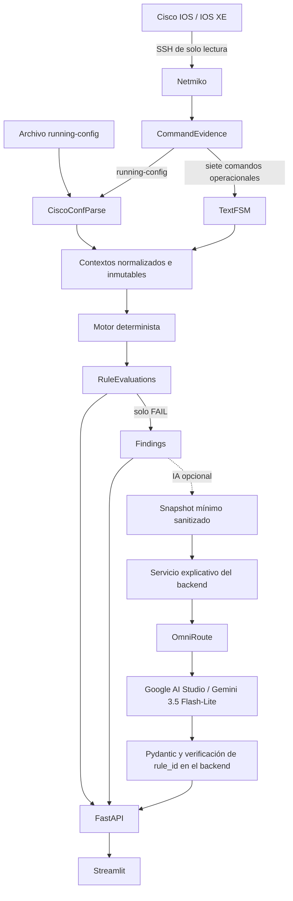

# NetAudit

**Las reglas detectan. La evidencia demuestra. La IA explica.**

NetAudit es un auditor/asistente de configuraciones Cisco IOS/IOS XE. Recolecta evidencia en modo de solo lectura y ejecuta reglas deterministas para detectar errores, inconsistencias, riesgos y malas prácticas. Opcionalmente utiliza IA para explicar los Findings que el motor ya generó.

El administrador puede revisar el resultado, su evidencia y la recomendación técnica. NetAudit no modifica dispositivos ni aplica configuraciones automáticamente.

## Estado actual

Estado verificado sobre el código de `main` el **2 de noviembre de 2026**.

| Capacidad | Estado |
|---|---|
| Motor determinista y parsing de configuración y datos operacionales | Implementado |
| Análisis de archivos locales | Implementado: 17 reglas de configuración |
| Análisis integral de dispositivos por SSH de solo lectura | Implementado: 24 reglas, 8 evidencias y 7 contextos operacionales |
| API FastAPI y contratos Pydantic | Implementado |
| Interfaz Streamlit con dashboard, filtros, temas e indicadores | Implementado |
| Explicación y conversación asistidas por IA | Implementadas y opcionales; desactivadas por defecto |
| Sanitización, exportaciones JSON/CSV y continuidad sin IA | Implementadas |
| Pruebas automatizadas y escenarios sintéticos | Implementados y verificados |
| Validaciones finales y documentación de cierre | En curso |

La persistencia relacional, el historial permanente, los reportes PDF del producto, la autenticación multiusuario y el soporte multifabricante **no están implementados**. La remediación automática queda fuera del alcance de operación de solo lectura. Estas capacidades no son requisitos para ejecutar el prototipo actual.

## Separación de responsabilidades

**El motor determinista** analiza los contextos, evalúa las reglas, determina sus estados, asigna la severidad definida por cada regla y genera Findings con evidencia y recomendaciones. Conserva todas las evaluaciones, incluidas las que no generan un hallazgo.

**La IA** explica y ayuda a interpretar Findings existentes. No detecta Findings, no decide `PASS`/`FAIL`, no cambia `rule_id`, severidad, estado, evidencia ni resultados. No abre SSH, no ejecuta comandos, no tiene acceso a Netmiko ni al collector y no aplica configuraciones.

La explicación es una salida separada. Si la IA no está disponible, los resultados deterministas continúan siendo válidos y la interfaz mantiene visibles los hallazgos y su evidencia.

## Arquitectura



La rama de IA comienza **después de los Findings**. Streamlit solo consume FastAPI: no se conecta directamente al proveedor ni al gateway. El backend prepara el contexto y valida la explicación antes de devolverla a la UI.

El diseño detallado está en [Arquitectura](docs/arquitectura.md) y en el [registro de integración de IA](docs/registro-integracion-ia.md). Los registros conservan sus cortes históricos; las capacidades actuales se resumen en este README.

## Flujo determinista

1. **Recolección:** se recibe un archivo o se consultan los ocho comandos autorizados en una sesión SSH.
2. **Evidencia:** se conserva la información de origen y se comprueba su integridad y coherencia.
3. **Parsing:** `ciscoconfparse2`, mediante la clase `CiscoConfParse`, procesa `running-config`; TextFSM procesa las salidas operacionales soportadas.
4. **Normalización:** se construyen `AnalysisContext`, `OperationalContext` y, cuando corresponde, `MultiSourceContext` inmutables.
5. **Reglas:** el motor ejecuta el catálogo habilitado en orden determinista.
6. **Evaluaciones:** cada regla devuelve una `RuleEvaluation` con estado, severidad, mensaje, recomendación y evidencia.
7. **Hallazgos:** únicamente una evaluación `FAIL` genera un `Finding`.
8. **Presentación:** FastAPI expone los resultados y Streamlit permite revisarlos, filtrarlos y exportarlos.

| Estado | Significado |
|---|---|
| `PASS` | La regla pudo evaluarse y la condición técnica se cumple. |
| `FAIL` | La regla pudo evaluarse y detectó un incumplimiento o riesgo. |
| `NOT_APPLICABLE` | La regla no corresponde al contexto analizado. |
| `NOT_EVALUATED` | La evidencia disponible no permite completar la evaluación. |
| `ERROR` | Ocurrió un error durante la evaluación. |

Una regla no evaluada no equivale a `PASS`. Los estados distintos de `FAIL` se conservan en las evaluaciones y no generan Findings.

### Catálogo actual

El análisis integral combina **24 reglas deterministas: 17 de configuración y 7 operacionales/multifuente**. El modo archivo ejecuta las 17 de configuración, porque no dispone de las salidas operacionales adicionales.

Las condiciones, recomendaciones, referencias y límites se encuentran en el [catálogo de reglas](docs/catalogo-reglas.md) y el [registro de ampliación del catálogo integral](docs/registro-controles-adicionales-evaluacion-2.md). Las reglas utilizan lógica Python y metadatos YAML; la IA no sustituye su evaluación.

[Demostración y resultados de Fase 3](docs/avance-fase3.md) · [Recorrido del código para la defensa](docs/guia-codigo-defensa.md).

### Comandos autorizados

El análisis integral utiliza exactamente estas ocho consultas, verificadas en la lista blanca del collector y en `CANONICAL_EVIDENCE_COMMANDS`:

```text
show running-config
show version
show ip interface brief
show ip ssh
show interfaces
show access-lists
show ntp associations
show ip ospf neighbor
```

Son comandos de lectura. El collector valida la lista antes de conectarse y usa `send_command()`. No acepta comandos arbitrarios, no ingresa al modo de configuración ni guarda cambios en el dispositivo.

### Evidencia y trazabilidad

Cada `CommandEvidence` conserva internamente el origen del dispositivo, comando, timestamp UTC, `execution_id`, salida original, salida normalizada y hash SHA-256. Las ocho evidencias de una ejecución comparten su identificador y se validan antes del análisis integral.

El parsing produce datos normalizados. La evidencia de una evaluación o Finding incluye fuente, hash, fragmento relevante y número de línea cuando corresponde. El DTO público integral omite el host de conexión, las salidas crudas, la configuración completa y los contextos completos; publica metadatos de comandos y evidencia sanitizada.

SHA-256 permite comprobar integridad. No cifra la evidencia ni aporta confidencialidad. La información se conserva en memoria durante los flujos actuales, sin una base de datos de auditorías persistentes.

## Interfaz actual

La interfaz en `apps/streamlit/app.py` permite:

- **Analizar archivo:** cargar una configuración UTF-8 `.cfg`, `.conf` o `.txt`, de hasta 2 MiB, sin abrir SSH.
- **Analizar dispositivo:** solicitar el análisis integral con credenciales transitorias en un laboratorio autorizado. La API limita los destinos a IPv4 privadas RFC 1918.
- **Resumen:** dashboard con KPIs de los cinco estados, total de evaluaciones, información del análisis y distribución de Findings por severidad.
- **Hallazgos:** filtros por severidad y regla, búsqueda por `rule_id`, nombre, mensaje o recomendación, y evidencia técnica colapsable.
- **Asistente IA:** explicar los Findings y mantener una conversación limitada al análisis seleccionado. La conversación permanece en la sesión de UI.
- **Evidencia:** revisar los metadatos publicados por el backend y los fragmentos de los Findings, sin salidas crudas completas.
- **Exportaciones:** descargar el resultado sanitizado en JSON y todos los Findings en CSV, independientemente de los filtros visibles. El CSV incorpora protección frente a fórmulas de hoja de cálculo.
- **Nuevo análisis:** limpiar el resultado visual, filtros, explicación y conversación anteriores.
- **Tema claro/oscuro:** seleccionar Light o Dark desde el menú de Streamlit.

Los filtros y las proyecciones visuales no modifican los resultados del motor. La UI no reconstruye hostname, IP o versión del dispositivo cuando el DTO no los publica.

### Indicadores de estado

| Indicador | Qué comprueba |
|---|---|
| NetAudit | Que el backend responde a `GET /health`. |
| Motor determinista | Que el catálogo responde a `GET /api/v1/rules`; no ejecuta una auditoría para comprobarlo. |
| OmniRoute | La accesibilidad HTTP que informa el backend mediante `GET /api/v1/ai/health`. |
| IA | Configuración, errores y última respuesta real validada en esa sesión. |

Un health accesible no demuestra inferencia ni disponibilidad del modelo. Antes de obtener una respuesta real, la UI puede indicar «Configurada · sin inferencia de prueba»; después de una respuesta `source=ai`, «Disponible · respuesta verificada». La etiqueta Gemini identifica el modelo del baseline validado, no un descubrimiento dinámico del modelo activo.

El estado se comprueba al abrir, mediante **Actualizar estado** o al interactuar después de 60 segundos. Los indicadores no generan inferencias de prueba ni realizan polling automático.

## Explicación asistida por IA

La integración está implementada y es opcional. El backend utiliza OmniRoute como gateway compatible con `chat/completions`. El proveedor validado es **Gemini de Google AI Studio**, con el modelo **Gemini 3.5 Flash-Lite** y el ID concreto `gemini/gemini-3.5-flash-lite`.

La inferencia real se documentó el **25 de octubre de 2026**, con explicación, conversación y conservación de los resultados deterministas. El refinamiento de interfaz también registra validaciones funcionales y resiliencia. Esta actualización del README no ejecuta una nueva inferencia ni confirma la disponibilidad actual del proveedor.

Antes de llamar al modelo, el backend crea un snapshot mínimo sanitizado de Findings existentes. No envía configuraciones completas, credenciales del dispositivo ni objetos de conexión. La autenticación con el gateway utiliza su encabezado HTTP; la clave no forma parte del contexto del modelo.

Los contratos Pydantic son cerrados y la respuesta debe referenciar exactamente los `rule_id` enviados, sin duplicados, omisiones ni identificadores inventados. La capa IA no tiene herramientas ni actions, acceso a Netmiko o funciones para alterar el análisis. Evidencia y pregunta se tratan como datos no confiables.

La sanitización ocurre antes de truncar y se aplica también a los textos de salida. El contexto tiene límites de tamaño y de número de Findings; si se recorta, se informa al usuario. Es una política conservadora que requiere revisión humana de la información real y de las explicaciones.

Ante IA desactivada, errores de autenticación, modelo no disponible, rate limit, timeout, caída del gateway o respuesta inválida, se devuelve un error público controlado y los resultados deterministas se conservan. Los reintentos están acotados. Sin Findings, el backend responde de forma determinista sin llamar al modelo.

Referencias: [integración, contratos y límites](docs/registro-integracion-ia.md), [validación real de Gemini](docs/registro-validacion-final-ia.md) y [validación de interfaz y resiliencia](docs/registro-refinamiento-ux-ui-fase2.md).

## Seguridad y restricciones

- **Solo lectura:** lista blanca exacta de comandos; sin aplicación automática de configuraciones ni remediación.
- **Credenciales transitorias:** no se persisten en archivos o base de datos ni se incorporan al resultado. La API usa `SecretStr` y la UI limpia los campos de conexión tras el intento.
- **Datos mínimos para IA:** sanitización de secretos, localizadores reconocibles y fragmentos antes de construir el contexto; no se envían salidas completas ni credenciales del dispositivo.
- **Aislamiento:** el paquete explicativo recibe Findings del backend, sin acceso al collector, SSH o herramientas de configuración. No utiliza cookies ni sesiones de proveedores web.
- **Datos no confiables:** la evidencia y las preguntas no se consideran instrucciones para cambiar la función del modelo.
- **Resultados inmutables respecto de IA:** la explicación no altera identificadores, severidades, `RuleStatus`, evidencia ni Findings.
- **Exportaciones sanitizadas:** JSON y CSV utilizan una lista explícita de campos públicos y redacción adicional de texto.
- **Operación local:** los comandos de arranque siguientes enlazan los servicios a loopback. No hay autenticación multiusuario ni certificación de seguridad del producto.

La revisión y aplicación manual de cambios corresponden al administrador. No deben publicarse configuraciones reales completas, credenciales, secretos o capturas que los contengan.

## Stack tecnológico

Las restricciones declaradas están en [pyproject.toml](pyproject.toml). Las versiones siguientes se observaron en el entorno virtual utilizado para la verificación del 2 de noviembre de 2026; no constituyen un lockfile ni una validación de todas las combinaciones permitidas por los rangos.

| Componente | Uso | Rango declarado / versión observada |
|---|---|---|
| Python | Dominio y servicios | `>=3.11` / `3.13.7` |
| FastAPI | API | `>=0.115,<0.116` / `0.115.14` |
| Uvicorn | Servidor ASGI | `>=0.34,<0.35` / `0.34.3` |
| Pydantic | Contratos y validación | Dependencia transitiva de FastAPI / `2.13.5` |
| Netmiko | Recolección SSH | `>=4.7,<5` / `4.8.0` |
| Paramiko | Transporte SSH utilizado por Netmiko | `>=4,<5` / `4.0.0` |
| ciscoconfparse2 | Clase `CiscoConfParse` para configuración | `>=0.8,<1` / `0.9.18` |
| TextFSM | Parsing operacional con plantillas propias | `>=2.1,<3` / `2.1.0` |
| Streamlit | Interfaz, extra `ui` | `>=1.40,<2` / `1.66.1` |
| HTTPX | Cliente de UI y gateway IA | `>=0.28,<0.29` / `0.28.1` |
| PyYAML | Metadatos de reglas | `>=6,<7` / `6.0.3` |
| pytest | Pruebas, extra `dev` | `>=8,<9` / `8.4.2` |

OmniRoute es un servicio externo al entorno Python. Google AI Studio y Gemini son el proveedor y modelo de la validación documentada; no son dependencias instaladas por `pip` en NetAudit.

El límite `paramiko>=4,<5` conserva compatibilidad con el KEX heredado del laboratorio CSR1000v IOS XE 16.9.5 documentado en el repositorio. Es una restricción acotada de laboratorio, no una recomendación de algoritmos heredados para producción. No se modifica el router para realizar la auditoría.

## Instalación en Windows

Desde la raíz del repositorio grupal, entrar al proyecto y crear un entorno virtual con Python 3.11 o posterior:

```powershell
cd Proyecto-Titulo-Cisco-IOS
python -m venv .venv
.\.venv\Scripts\Activate.ps1
python -m pip install -e ".[dev,ui]"
```

El extra `dev` instala pytest y `ui` instala Streamlit. Después de crear el entorno también puede utilizarse directamente `.\.venv\Scripts\python.exe`, sin depender de la activación de PowerShell.

PostgreSQL, SQLAlchemy, Alembic, Docker y WSL no son necesarios para ejecutar las capacidades implementadas. La IA requiere adicionalmente un gateway OmniRoute y un proveedor configurados; el análisis determinista funciona sin ellos.

## Ejecución local

Todos los comandos siguientes se ejecutan desde `Proyecto-Titulo-Cisco-IOS/`.

### Backend FastAPI

En una terminal PowerShell:

```powershell
$env:PYTHONUTF8 = '1'
$env:NETAUDIT_AI_ENABLED = 'false'
.\.venv\Scripts\python.exe -m uvicorn ios_auditor.api.app:app --host 127.0.0.1 --port 8000
```

La API queda en `http://127.0.0.1:8000`. Su documentación interactiva está en `/docs` y `/redoc`.

### Interfaz Streamlit

En otra terminal, con el mismo directorio de trabajo:

```powershell
$env:NETAUDIT_API_BASE_URL = 'http://127.0.0.1:8000'
.\.venv\Scripts\python.exe -m streamlit run apps/streamlit/app.py --server.address 127.0.0.1 --server.port 8501
```

Abrir `http://127.0.0.1:8501`. La configuración versionada de Streamlit mantiene loopback, carga máxima de 2 MiB y telemetría de uso desactivada.

### Configurar IA opcional

[.env.example](.env.example) documenta las variables sin credenciales. La aplicación **no carga automáticamente ese archivo ni un `.env`**: lee las variables del proceso que inicia FastAPI. Configurarlas antes de arrancar el backend, o reiniciarlo después de cambiarlas.

| Variable | Propósito / valor por defecto |
|---|---|
| `NETAUDIT_AI_ENABLED` | Activa la capa explicativa; `false` por defecto. |
| `NETAUDIT_AI_BASE_URL` | URL del gateway; `http://127.0.0.1:20128/v1`. |
| `NETAUDIT_AI_API_KEY` | Credencial local de OmniRoute, obtenida mediante configuración privada; sin valor real versionado. |
| `NETAUDIT_AI_MODEL` | ID concreto; vacío por defecto. No se admite `auto`. |
| `NETAUDIT_AI_TIMEOUT_SECONDS` | Timeout por intento; `15` segundos por defecto. |
| `NETAUDIT_AI_MAX_RETRIES` | Reintentos acotados a `0` o `1`; `1` por defecto. |
| `NETAUDIT_API_BASE_URL` | Backend que consume la UI; `http://127.0.0.1:8000`. |

El baseline validado utilizó esta configuración no secreta:

```powershell
$env:NETAUDIT_AI_ENABLED = 'true'
$env:NETAUDIT_AI_BASE_URL = 'http://127.0.0.1:20128/v1'
$env:NETAUDIT_AI_MODEL = 'gemini/gemini-3.5-flash-lite'
$env:NETAUDIT_AI_TIMEOUT_SECONDS = '30'
$env:NETAUDIT_AI_MAX_RETRIES = '0'
```

La clave local del gateway se proporciona de forma privada al proceso mediante `NETAUDIT_AI_API_KEY` cuando la autenticación lo requiere. La credencial del proveedor se configura en OmniRoute. No guardar valores reales en scripts, documentación, capturas o Git.

### CLI y carga por API

Análisis offline con salida JSON:

```powershell
.\.venv\Scripts\python.exe -m ios_auditor analyze samples/running_config_incorrecta.cfg --pretty
```

Carga de archivo mediante FastAPI:

```powershell
curl.exe -X POST "http://127.0.0.1:8000/api/v1/analyses" -F "file=@samples/running_config_incorrecta.cfg"
```

## API disponible

| Método y ruta | Función |
|---|---|
| `GET /health` | Estado y versión del backend. |
| `GET /api/v1/rules` | Las 17 reglas habilitadas de configuración. |
| `POST /api/v1/analyses` | Analizar un archivo en memoria. |
| `GET /api/v1/analyses/{analysis_id}` | Consultar un análisis de archivo retenido en memoria. |
| `GET /api/v1/analyses/{analysis_id}/evaluations` | Evaluaciones del análisis de archivo. |
| `GET /api/v1/analyses/{analysis_id}/findings` | Findings del análisis de archivo. |
| `POST /api/v1/device-analyses` | Recopilar y analizar un dispositivo de forma síncrona. |
| `GET /api/v1/ai/health` | Estado de configuración y accesibilidad HTTP del gateway, sin inferencia. |
| `POST /api/v1/analyses/{analysis_id}/ai-explanation` | Explicar Findings existentes, con una pregunta opcional. |

Para explicar un archivo se usa su `analysis_id`; para un dispositivo se usa el `execution_id` devuelto por el análisis integral. Ambos identifican un contexto del backend. La UI no envía Findings editables al endpoint de IA.

El repositorio temporal de archivos conserva hasta 100 resultados y el de IA hasta 100 snapshots sanitizados. Se pierden al reiniciar y los más antiguos se expulsan al alcanzar el límite. El endpoint integral no añade un historial permanente ni una API de consultas históricas de dispositivos.

## Pruebas y validación

Ejecutar la suite ordinaria:

```powershell
$env:PYTHONUTF8 = '1'
.\.venv\Scripts\python.exe -m pytest -q
```

Resultado real del **2 de noviembre de 2026**, antes de esta actualización documental:

```text
852 passed, 1 warning
```

**0 failed.** El warning conocido es un `DeprecationWarning` de Starlette sobre el alias `anyio.abc.BlockingPortal`; no es un fallo de las reglas ni de la suite.

Los tests ordinarios usan fixtures sintéticas, fakes, mocks, `TestClient` y pruebas de interfaz. No requieren IA en vivo ni abren sesiones SSH reales. Las pruebas live opcionales están fuera de `testpaths`, en `tests_live/`, y no forman parte de esta ejecución.

### Validación sintética integral

```powershell
.\.venv\Scripts\python.exe scripts/evaluacion_2/run_validation_scenarios.py --summary-only
```

Resultado verificado en esta revisión: **3 escenarios × 24 reglas = 72 evaluaciones coincidentes**, con **0 diferencias y 0 errores de contrato** de orden o Findings.

Son escenarios **sintéticos/offline**. No representan 72 ejecuciones contra un router físico o virtual. Las validaciones reales de laboratorio y de IA se conservan por separado en sus registros; esta revisión no repitió SSH ni inferencia en vivo.

## Estructura del proyecto

```text
Proyecto-Titulo-Cisco-IOS/
├── .env.example
├── pyproject.toml
├── .streamlit/
│   └── config.toml
├── apps/
│   └── streamlit/app.py
├── src/
│   └── ios_auditor/
│       ├── ai/
│       ├── api/
│       ├── collectors/
│       ├── domain/
│       ├── parsers/
│       ├── resources/
│       ├── rules/
│       ├── services/
│       └── ui/
├── tests/
│   ├── integration/
│   └── unit/
├── tests_live/
├── scripts/
│   └── evaluacion_2/
├── samples/
└── docs/
```

## Documentación relacionada

- [Arquitectura](docs/arquitectura.md).
- [Decisiones técnicas](docs/decisiones-tecnicas.md).
- [Catálogo de reglas](docs/catalogo-reglas.md).
- [Integración de IA, configuración y contratos](docs/registro-integracion-ia.md).
- [Validación real de Gemini e invariantes](docs/registro-validacion-final-ia.md).
- [Interfaz actual, exportaciones y resiliencia](docs/registro-refinamiento-ux-ui-fase2.md).
- [Registro del catálogo integral de 21 reglas](docs/registro-controles-adicionales-evaluacion-2.md).
- [Escenarios sintéticos y sus límites](samples/evaluacion_2/README.md).
- [Persistencia relacional definida, todavía no implementada](docs/definicion-incremento-9-persistencia-relacional.md).

## Equipo y contexto

Proyecto de Título de **Ingeniería en Conectividad y Redes, Duoc UC**.

| Integrante | Área principal de coordinación |
|---|---|
| Axl Urrutia | Arquitectura, backend e integración |
| Thomas Henriquez | Laboratorio y validación de red |
| Maikol Mamani | Reglas, seguridad y pruebas |
| Emilio Cortes | Interfaz y documentación |

El trabajo es colaborativo; estas áreas no atribuyen autoría exclusiva de módulos. Los entregables y la planificación académica se mantienen en [Entregables-APT](../Entregables-APT/), separados de la identidad técnica del producto.
